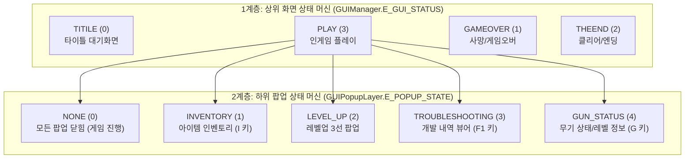
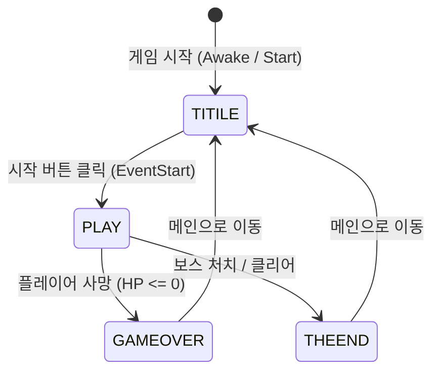
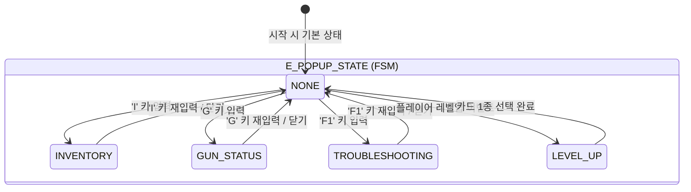
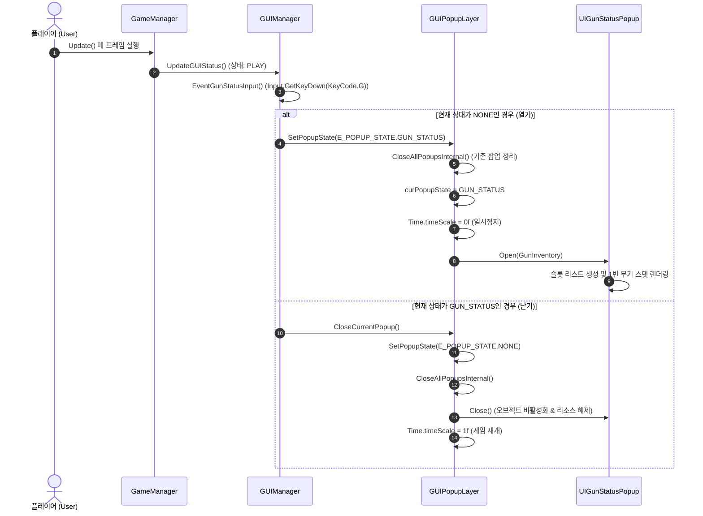
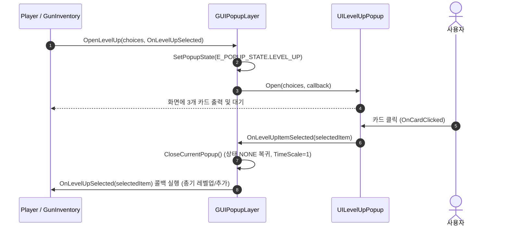
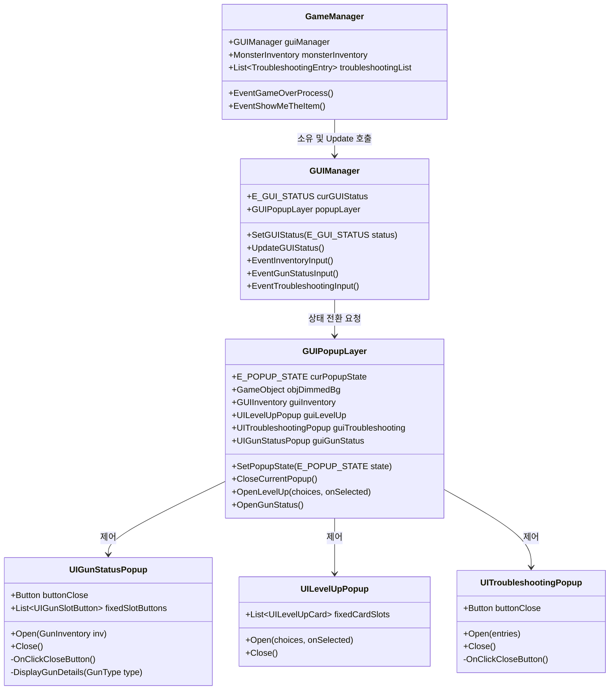

# 🎮 Unity VSLike Game - GUI & 상태 머신(FSM) 아키텍처 가이드

본 문서는 본 프로젝트의 **GUI 화면 관리(Screen FSM)** 및 **팝업 레이어(Popup FSM)**의 상태 전이(State Transition) 의미와 구조, 클래스 간 데이터 흐름을 상세히 정리한 아키텍처 분석 문서입니다.

---

## 1. 🏗 2계층 상태 머신(FSM) 아키텍처 개요

본 프로젝트의 GUI 시스템은 단일 상태 머신 대신 **화면 레벨(Screen-Level)**과 **팝업 레벨(Popup-Level)**의 **2계층 유한 상태 머신(2-Tier FSM)** 구조로 설계되어 있습니다.

---

## 2. 🖥 1계층: 상위 화면 상태 머신 (`E_GUI_STATUS`)

`GUIManager` 클래스에서 관리하며, 전체 씬의 메인 UI 뷰(타이틀, 인게임, 게임오버, 엔딩)를 활성화/비활성화하고 게임 일시정지(`Time.timeScale`)를 제어합니다.

### 2.1 상태(Enum) 정의 및 의미

| 상태 (`E_GUI_STATUS`) | 인덱스 | 의미 및 역할 | `Time.timeScale` | 전이 가능 상태 |
| :--- | :---: | :--- | :---: | :--- |
| **`TITILE`** | 0 | 게임 시작 전 타이틀 화면. 시작 버튼 대기 | `0f` (정지) | `PLAY` |
| **`GAMEOVER`** | 1 | 플레이어 사망 시 게임 오버 화면 | `0f` (정지) | `TITILE` / 재시작 |
| **`THEEND`** | 2 | 스테이지 클리어 및 최종 승리 화면 | `0f` (정지) | `TITILE` |
| **`PLAY`** | 3 | 인게임 플레이 화면 (HUD 활성화, 키 입력 처리) | `1f` (팝업 열림 시 `0f`) | `GAMEOVER`, `THEEND` |

### 2.2 상위 화면 상태 전이도

---

## 3. 🪟 2계층: 하위 팝업 상태 머신 (`E_POPUP_STATE`)

`GUIPopupLayer` 클래스에서 관리하며, 게임 플레이 도중 화면 위에 뜨는 모달(Modal) 팝업들을 전담합니다. 팝업이 활성화되면 뒷배경 딤드(`objDimmedBg`)가 켜지고 `Time.timeScale = 0f`로 설정되어 인게임이 안전하게 일시정지됩니다.

### 3.1 상태(Enum) 정의 및 세부 동작

| 상태 (`E_POPUP_STATE`) | 트리거 (단축키 / 이벤트) | 활성화 오브젝트 | 배경(Dimmed) | `Time.timeScale` | 세부 동작 |
| :--- | :--- | :--- | :---: | :---: | :--- |
| **`NONE`** | 닫기(X), 단축키 재입력, 선택 완료 | 모두 비활성화 | ❌ Off | **`1f` (재개)** | 모든 팝업창을 닫고 게임 정상 진행 |
| **`INVENTORY`** | `I` 키 토글 | `GUIInventory` | ⭕ On | `0f` (정지) | 몬스터 처치로 획득한 전리품 목록 조회 |
| **`LEVEL_UP`** | 경험치 충족 (레벨업) | `UILevelUpPopup` | ⭕ On | `0f` (정지) | 무작위 3종 총기/아이템 선택 카드 제공 |
| **`TROUBLESHOOTING`** | `F1` 키 토글 | `UITroubleshootingPopup`| ⭕ On | `0f` (정지) | 실시간 트러블슈팅 히스토리 스크롤 뷰 |
| **`GUN_STATUS`** | `G` 키 토글 | `UIGunStatusPopup` | ⭕ On | `0f` (정지) | 좌측(총기 목록) + 우측(스탯/레벨/설명) 뷰 |

### 3.2 팝업 상태 전이 다이어그램

---

## 4. 🔄 데이터 및 이벤트 흐름 (Event Flow)

### 4.1 키보드 입력 처리 흐름 (`G` 키 무기 상태창 기준)

### 4.2 레벨업 팝업 선택 처리 흐름

---

## 5. 🏛 클래스 다이어그램 및 컴포넌트 역할

---

## 6. 💡 핵심 설계 원칙 및 트러블슈팅 포인트

1. **단일 진입점(Single Source of Truth) 원칙**
   - 팝업의 열기/닫기와 `Time.timeScale` 조작은 오직 `GUIPopupLayer.SetPopupState()`를 통해서만 실행됩니다.
   - 각 하위 팝업 클래스는 본인이 직접 `Time.timeScale`을 건드리지 않고, 상위 `GUIPopupLayer`에 요청만 전달합니다.

2. **재귀 호출(Recursion) 방지 구조**
   - **이전 문제점**: 팝업의 `Close()` 내부에서 다시 상위 `popupLayer.CloseCurrentPopup()`을 호출하여 무한 루프 발생.
   - **해결책**:
     - 사용자가 UI 닫기 버튼을 눌렀을 때: `OnClickCloseButton()` -> `popupLayer.CloseCurrentPopup()` 호출.
     - `GUIPopupLayer`가 팝업을 닫을 때: `Close()` -> 순수 오브젝트 비활성화 및 리스트 정리만 수행.

3. **초심자 친화적(Beginner-Friendly) C# 코딩 규칙**
   - 인라인 람다식 및 복잡한 LINQ 쿼리를 지양하고, 명확한 함수명과 기본 제어문(`switch`, `if/else`, `for`) 및 델리게이트 콜백으로 작성되었습니다.
